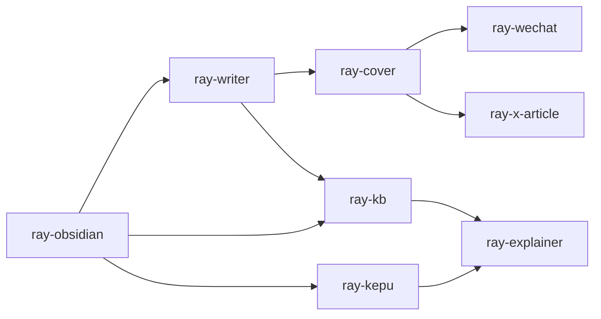

<div align="center">

# rayskills

**中文 AI Skills：写长文、口播稿和科普稿，做封面和解说视频，存公众号和 X 草稿。**


[](#skill-目录)
[](#安装)

[GitHub](https://github.com/imraywang/rayskills) · [Gitee（国内镜像）](https://gitee.com/imraywang/rayskills)

</div>

---

rayskills 是 Ray 做的一套中文 AI Skills，共 9 个，装进 Claude Code、Codex 或 WorkBuddy 后，Agent 可以把一个想法一路做成文章、封面、口播稿或解说视频，并存进公众号和 X 的草稿箱。**它只做到草稿，不替你发布。**

## 安装

```bash
npx -y skills add imraywang/rayskills -g --all
```

国内访问 GitHub 慢时，从 Gitee 镜像拿代码：`git clone https://gitee.com/imraywang/rayskills.git`。从旧版本升级、WorkBuddy 导入，见 [版本与升级](docs/版本与升级.md)。

## 怎么用

不用记名字，把处境交给 `/ray`。下一步还不确定时，它只选此刻最该做的一步；你给了明确的终点，它就连续做完，停在草稿。

```text
/ray 把这个 idea 写成文章，做公众号和 X 封面，再放进两个平台的草稿箱
/ray 这篇英文文章写得很好，想翻译过来发公众号
/ray 我刚有一个灵感，查完资料就想直接录一条口播
/ray 把这篇定稿做成 2 分钟竖屏解说视频，用我的声音
```

熟悉之后也可以直接叫某一个，比如 `/ray-writer 把这条剪藏写成一篇公众号长文`。更多例子见 [新手入门](docs/新手入门.md)。

## Skill 目录

| Skill | 你给它 | 它做出 |
|---|---|---|
| **`/ray`** | 一个处境或一个终点 | 选下一步，或把整条链路连续做完 |
| `/ray-obsidian` | 一个空目录或已有的 Obsidian 库 | 内容知识库的骨架；已有文件不覆盖、不移动 |
| `/ray-writer` | idea、剪藏、调研或草稿；别人的文章 | 作者口吻的中文长文；带授权和署名的译介稿 |
| `/ray-kb` | 一个灵感，或一篇定稿长文 | 能直接开机录的口播稿；也审读口播稿、对照实际录的稿子 |
| `/ray-kepu` | 一件事、一个原理、一份新数据 | 讲解者视角的科普旁白稿，作者的观点不是主角 |
| `/ray-cover` | 定稿的文章或视频 | 公众号、X、X Article 封面；真人照片 + 大标题的视频封面 |
| `/ray-explainer` | 文章、观点或口播稿 | 配音解说视频：复刻音色、逐字卡点，画面每期单独设计，真实画面优先 |
| `/ray-wechat` | 定稿和公众号封面 | 手机预览，确认后写入公众号草稿并回读核对 |
| `/ray-x-article` | 定稿和 5:2 封面 | 写入 X Articles 草稿，核对格式、封面和预览 |



不随本仓库安装、装了才会被 `/ray` 交过去的：咨询、多模型协作、趋势调研、拼贴 B-roll 在 [ray-skills](https://github.com/imraywang/ray-skills)；真人口播按风格剪片由独立项目 `ray-studio` 负责。成员之间怎么衔接见 [Skill 关系图](docs/skill-link-map.md)。

## 先填作者档案

写作和封面这几个 Skill，把和具体的人有关的东西单独放在各自目录的 `author-profile.md` 里，`SKILL.md` 只管怎么判断：

| Skill | 档案里放什么 |
|---|---|
| `ray-writer`、`ray-kb`、`ray-kepu` | 身份与读者、表达偏好、允许 AI 补什么、样本清单 |
| `ray-cover` | 品牌色、禁用项、能不能用真人照片、默认风格和尺寸 |

仓库里带的是 Ray 自己的档案。你自己用时，把同目录的 `author-profile.template.md` 覆盖到 `author-profile.md` 再填。可以只写几条明确知道的，边用边补；没填的项不会被 AI 自动补全。

## 它守住的边界

| 边界 | 做法 |
|---|---|
| 不替你发布 | 平台动作只到验证过的草稿。“推送”“走完整流程”不算发布授权，含糊的说法先做本地产物再问一句 |
| 不动你的东西 | 知识库里已有的文件不覆盖、不移动；草稿优先更新原来那一份，不重复建 |
| 不把别人的文章当原创 | 译介先过授权和署名，授权没落地只做本地产物 |
| 不把“接口成功”当完成 | 写入之后回读核对：标题、封面、全文、编码、格式 |
| 不替你编 | 能不能编补经历和数字由作者档案决定，补了的在交付时点出来 |

## 文档

- [新手入门](docs/新手入门.md)：第一次怎么用
- [Skill 关系图](docs/skill-link-map.md)：成员之间的常见衔接
- [长文生产管线](skills/ray/references/content-pipeline.md)：从写作到平台草稿的交接与恢复
- [版本与升级](docs/版本与升级.md)：从旧版本升级、版本历史、WorkBuddy 与豆包、实测数据
- [本地知识库结构](skills/ray-obsidian/references/vault-schema.md)：目录各放什么

## 许可

rayskills 的内容遵循仓库根目录的 CC BY-NC 4.0。`ray-cover` 内置的 Punk 风格库按 MIT 协议保留原版权与许可，见 `skills/ray-cover/assets/punk/NOTICE.md`。不再使用的做法归档在 `docs/archive/`，不随 Skill 分发。

---

<div align="center">
<sub>rayskills · 作者 <a href="https://x.com/wangray">@wangray</a></sub>
</div>
