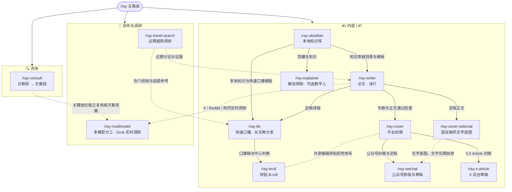

# rayskills 关系图

`/ray` 是主入口，默认读上下文分发到一个成员 skill。用户明确要求从 idea 一路做到公众号或 X 草稿时，使用已经验证的内容生产管线连续执行；线上写入和发布仍分别守住确认边界。

## 衔接逻辑

- **咨询漏斗**:`ray-consult` 内部完成诊断段(免费诊断,漏斗入口)→ 方案段(付费方案)的正式交接。红灯诊断时,方案 Phase 0 = 补齐前提。
- **知识库 → 长文 → 封面 → 平台草稿**：没有兼容知识库时，`ray-obsidian` 先安全建立资料、知识、成稿包、草稿和发布结构；`ray-writer` 完成事实、情绪、二级标题、重点加粗和段落检查；`ray-cover` 从核心判断出发，按公众号、普通 X、5:2 Article 各自尺寸分别用 Image 2 直出，验收构图与安全区；`ray-wechat` 负责公众号排版、预览确认、原草稿更新和 UTF-8 回读；`ray-x-article` 负责 X 草稿续写或查重、富文本写入、封面裁切、预览和保存。用户明确要求完整管线时连续执行，线上写入与发布仍由用户确认。
- **译介支线**：内容主体属于别人的文章，`ray-writer` 译介模式先过授权与署名两道门；`source_permission` 没放行时 `ray-wechat` 与 `ray-x-article` 都只做本地产物。
- **灵感 → 快速口播**：当一个现场观察或对话判断已经能在一条视频里讲清，`ray-kb` 按需检索素材、以作者口吻直接写，只建立一份 `fast-oral` 母稿，拿不准的内容列进「待确认」；不强制创建候选卡、写作任务、长文或第二份内容包。
- **母稿 → 多次分发**：`ray-kb` 把 `ray-writer` 通过检查的长文作为唯一真源，重新选一个适合视频的判断，生成带母稿指纹、以作者口吻写成的口播稿；需要拼贴画面时再交给 `ray-broll`。公众号和 X 继续各自做格式转换，图片长文先保留视觉接口，后续再接独立样式系统。
- **剪藏 → 解说视频**：`ray-explainer` 把文章或剪藏写成解说稿，先出分镜表等确认，再配音、逐字卡点、代码绘制画面；数字人主持人默认不加，用户确认后才先报价再生成。要每期专属风格、真实截图和录屏时改走 HyperFrames 模式，配音和卡点不变，发布包并进 `ray-kb` 的口播母稿。
- **统一画风封面**：想让所有文章封面保持同一种视觉、文字后期自己排时，用 `ray-cover-editorial` 出三个平台尺寸的无字底图；需要一文一隐喻时仍走 `ray-cover`。
- **近期趋势 → 写作素材**：`ray-trend-search` 汇总 X、Reddit、YouTube、HN、抖音、视频号与公开网页的近期讨论，日期和证据边界写清楚，再交给 `ray-writer` 或 `ray-kb` 使用。
- **主控 → 外部通道**:`ray-multimodel` 只在大体量执行、独立复核、方案竞赛，或 X / Reddit / 网页实时调研有明确收益时启用。`scout` 使用隔离的 Grok 搜索流程，默认 quick，明确要求深度核实时使用 deep；当前会话始终负责最终验收。

## 精简说明

- **v2** 按成熟度精简：`ray-diagnose` + `ray-proposal` 合并为 `ray-consult`，`ray-vpsinit` + `ray-nodecheck` 合并为 `ray-vps`，`ray-thread` 并入 `ray-writer` 的 thread 骨架模式；`ray-tweet`、`ray-idea`、`ray-cleanup`、`ray-weekly` 删除。
- **v3** 按使用频率收敛：`ray-benchmark`、`ray-launch`、`ray-metrics`、`ray-report`、`ray-vps` 移出到独立仓库 [ray-skills](https://github.com/imraywang/ray-skills)，完整保留、按需独立使用；`ray-consult` 经复核保留为咨询线成员。
